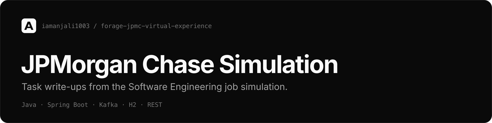
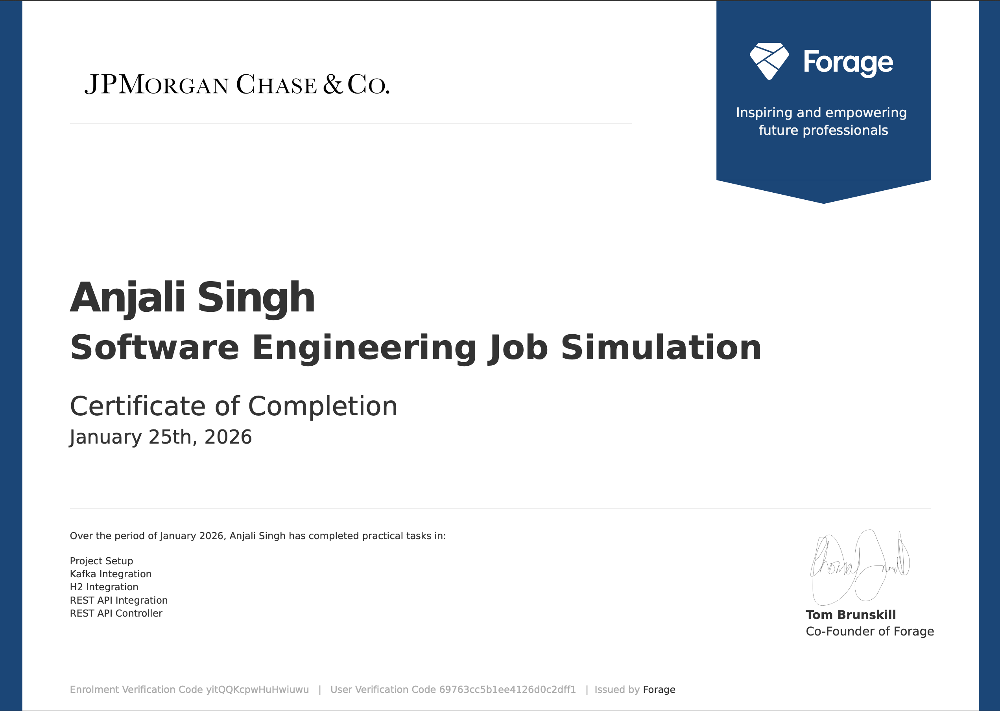

Task write-ups from JPMorgan Chase's Software Engineering job simulation on Forage, January 2026.

[Code](https://github.com/iamanjali1003/forage-midas) · [Certificate](assets/certificate.png)

## Overview

A guided simulation in five tasks. Each one adds a piece to Midas Core, a
Spring Boot service that processes financial transactions. The code lives in
[forage-midas](https://github.com/iamanjali1003/forage-midas); this repository
holds the write-up for each task.

## What I built

- A Kafka consumer that reads transaction messages from a configurable topic,
  tested against an embedded Kafka broker
- Transaction validation and persistence with Spring Data JPA on an H2 database,
  updating sender and recipient balances
- A call to an external REST Incentive API with `RestTemplate`, adding the
  incentive to the recipient's balance
- A `GET /balance` endpoint that returns a user's balance as JSON
- Each task checked with its Maven test suite

## Tech stack

| Area | Choice |
| --- | --- |
| Language | Java 17 |
| Framework | Spring Boot 3 |
| Messaging | Apache Kafka |
| Persistence | Spring Data JPA, H2 |
| HTTP | `RestTemplate`, Spring Web |
| Build | Maven |

## Tasks

| Task | Title | Status |
| --- | --- | --- |
| [Task 1](task-1.md) | Project setup | Completed |
| [Task 2](task-2.md) | Kafka integration | Completed |
| [Task 3](task-3.md) | H2 integration | Completed |
| [Task 4](task-4.md) | REST API integration | Completed |
| [Task 5](task-5.md) | REST API controller | Completed |

## Certificate

## License

[MIT](LICENSE) © 2026 [Anjali](https://iamanjali1003.github.io)
